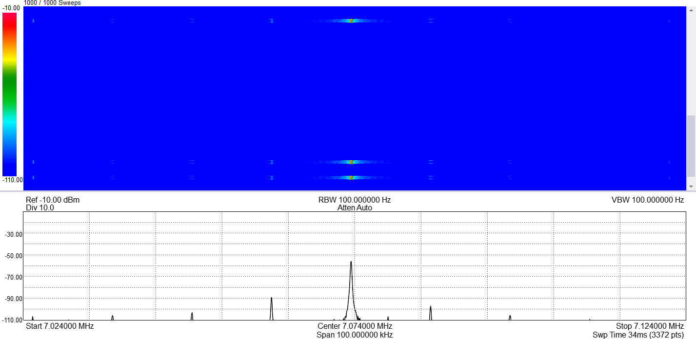
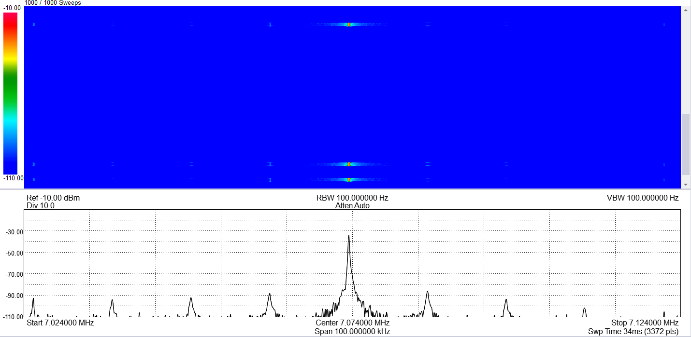
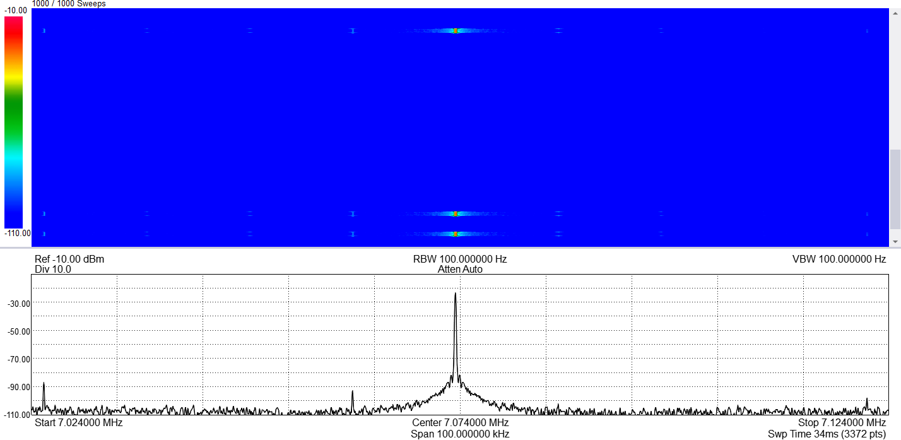

# For Ron: answers on the 12 kHz comb, and one radio fix for every mode

From Stew, 2026-11-02. Reply to your `NOTE-FOR-STEW-TX-EDGE-COMB-CW-2026-11-02.md`. Thanks for
the DMA-chain read-out; it saved us a lot of digging.

## Your questions

**1. Why only at key-up?** It isn't, in CW. Our note was wrong for CW: it comes on **both** edges.
Stew sent one 5 wpm dash, non-QSK, and caught it in three pictures:

| Picture | Moment | Carrier | Comb |
|---|---|---|---|
| 6 | ramp | -56 dBm | yes |
| 7 | ramp | -35 dBm | yes |
| 8 | steady, mid-dash | -24 dBm | no |

So in CW the DAC unmutes over trans's carrier, which is already there, and the 0.5 dB staircase
shows on the way up as well as down. The "key-down is clean" in our note is true only for TUN,
2 TONE and SSB / DIG: there the DAC unmutes before trans's signal arrives, so it ramps silence.

**2. Can you hear it on the air?** No. CW sounds fine on another receiver. The comb shows only on
the analyzer (about -65 dBc). So this is a cleanliness fix, not an urgent one.

**3. Option 2 for TUN / 2 TONE / SSB, or one fix in the radio?** Our suggestion: one fix in the
radio that covers everything, CW included, if it fits in the 8051. Your design is a good base for
that (see below).

## A suggestion on your design: fade the live buffer, not a stored carrier

Your plan grabs one packet of carrier in CW receive and replays it. A small change would make the
same mechanism work in every mode:

- **During a fade only**, take the slot USB has just filled (the one after the slot that's
  playing). The 8051 copies it into a scratch buffer with the raised-cosine gain applied (192
  multiplies), then `PCM3060_SetTxBufAddress()` points that slot's Buff TD at the scratch buffer.
  Afterwards it goes back to `PCM3060_SetTxBufAddressDefault()`.
- In CW, trans streams the carrier all the time, so this fades the carrier exactly as your stored
  copy would. Loop alignment, the grab, and holding a copy while keyed aren't needed.
- In TUN, 2 TONE and SSB / DIG the same code fades whatever is playing at release before the PA
  goes off. Then the DAC soft mute isn't needed for any mode, so there's no comb anywhere, and no
  host changes (no trans fade, no latency to measure, Windows and Pi alike).
- Key-down: fade up from zero, timed against the key delay as 3.240 does now. Key-up: fade down,
  then PA off once the fade is done (replacing the 18 ms `TX_DAC_RAMP_MS` wait on the soft mute).
- Your "Zero TDs at a dummy byte" change may not be needed. The copy-and-scale only has to finish
  before the DAC reaches that slot, which is up to about 1 ms after USB filled it. If that's too
  tight next to USB and the keyer, your dummy-Zero change gives more room.

What we don't know, and you're better placed to judge:

1. Does a 192-sample 16x16 multiply plus copy fit in the time left in each ms on the 8051? We
   estimate roughly 0.2-0.4 ms (no hardware 16x16 multiplier), which looks OK, but only during
   fades. A 256-entry gain table and 8x16 multiplies could make it cheaper.
2. Is there a clean point in the main loop to learn that USB has just filled a slot (after
   `Audio_Main` starts the USB DMA) so the scaling can follow straight after?
3. Fade length: about 5 ms raised cosine gives a narrow spectrum and no comb. Is that your
   preference too?

## Other points

- DAC kept muted in RX (3.243 / 4.244): staying in, as you said.
- The beep at the end of 2 TONE: the recv 50 ms mute test is on our list for Windows.
- 0x2E client side: also on our list, with Windows ms-sdr logging and ignoring 0x2E.
- The SWR meter questions (firmware source, A or B, 25 W, flashing): Stew will answer separately.
