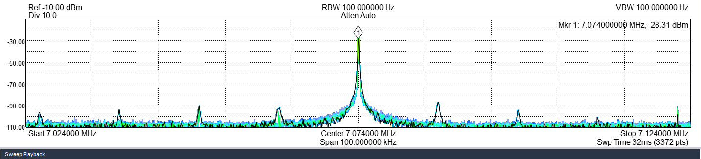
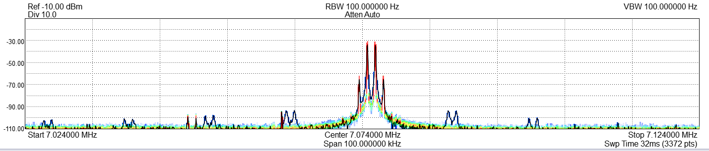
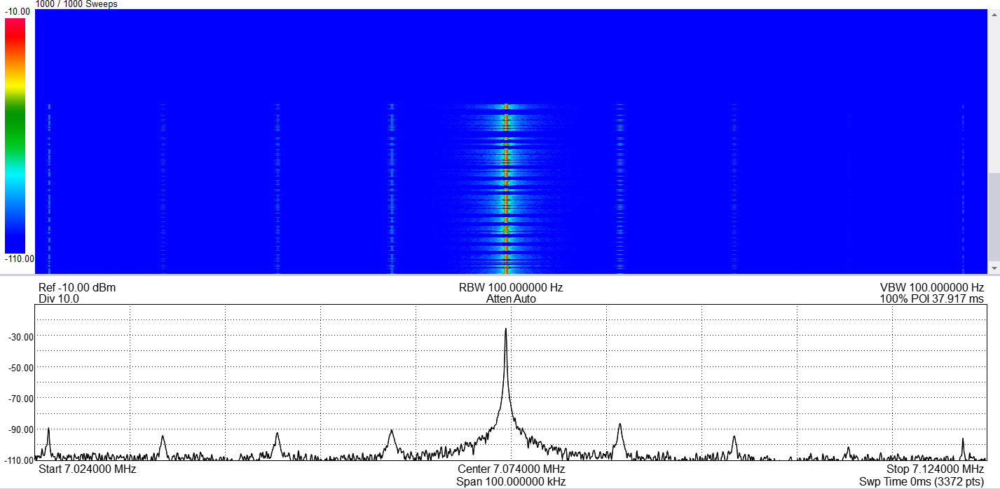
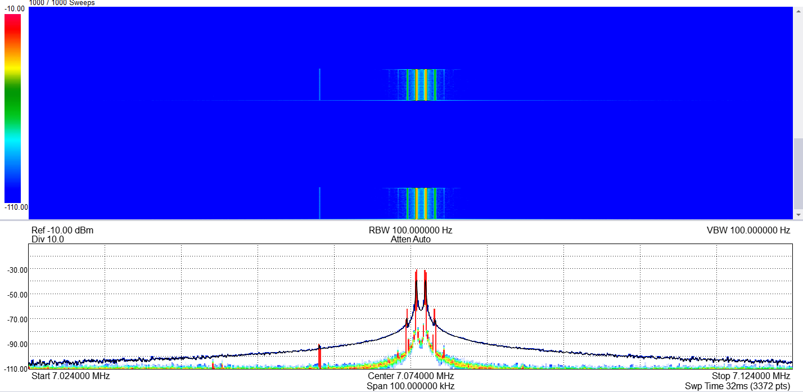
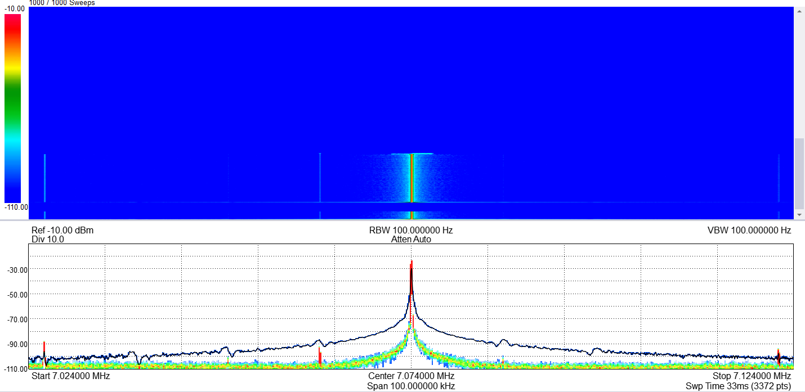

# For Ron: 12 kHz comb at every TX ramp-down (PCM3060 soft mute), and an ATU timer fix

From Stew, 2026-11-02. Signal Hound on 40 m (7.074 MHz), 100 kHz span, 100 Hz RBW, with a Proficio
MKII PTT and an Ultimus MKII ATU. Pictures are in `.mscc-coord/RESULTS/2026-11-02-tx-edges/`. You
know the audio / DAC side better than we do, so we'd like your view on a fix.

## 1. ATU firmware: the 1 ms tick ran fast (fixed, 4.244 / Ultimus 7.244)

On the MKII ATU (Proficio 4.243 and Ultimus 7.243) TUN and 2 TONE showed wide-band noise at
key-down and release (picture 5). The PTT build didn't. The application code is identical; the
difference was in the schematic:

| | `Key_Delay_isr` interrupt type |
|---|---|
| MKII PTT 3.242 | RISING_EDGE (`int_type "00"` in the .rpt) |
| MKII ATU 4.243 | DERIVED (`int_type "10"`), which acts as level on the timer TC |

The TC pulse is high for a whole CW_Clock period, so the level interrupt fired several times per
ms and `E_ms_tick` ran fast. Every delay was too short: the 18 ms DAC ramp before PA off, the
20-40 ms key delay, and the CW key delay. The PA switched with RF up. Stew set the ISR to
RISING_EDGE in the ATU TopDesign (CW Management sheet). The wide-band edges are gone.

If you ever add `Key_Delay_Timer` to another PSoC project, set the ISR to **RISING_EDGE**.

## 2. The comb: spurs 12 kHz apart for ~16 ms at every ramp-down (all firmwares, non-QSK)

With non-QSK on any radio, release from TUN, 2 TONE, SSB / DIG PTT, and every CW element
key-up show a short comb about **65 dB below the carrier**: carrier ±12, 24, 36 … kHz.

| Picture | What | Comb | Wide-band edges |
|---|---|---|---|
| 1 | TUN, MKII PTT 3.242, non-QSK | yes, at release | no |
| 2 | 2 TONE, MKII PTT 3.242, non-QSK | yes, at release | no |
| 3 | CW, non-QSK (waterfall: one burst per element) | yes, each key-up | no |
| 4 | 2 TONE with **POTENTIA/QSK checked** | **no** | **yes**, at both edges |
| 5 | TUN, MKII ATU 4.243 before the ISR fix | low, under the noise | yes (section 1) |

**Our explanation.** The comb is the PCM3060 soft mute (reg 0x44, MUT21/MUT22) we use as the RF
envelope since 3.241:

- It steps the DAC attenuation 0.5 dB every 8/fs. At 96 kHz that's a staircase at
  **96,000 / 8 = 12 kHz**.
- A 12 kHz staircase on a steady carrier gives sidebands at exactly ±n × 12 kHz.
- At key-down the DAC unmutes before trans's carrier or tones arrive, so the staircase acts on
  silence and there's no comb. At release it ramps a full carrier down.
- QSK skips the soft mute, so the comb goes away (picture 4). But the PA then switches with RF up,
  which is the wide-band splatter at both edges. So QSK isn't a fix; it's the old hot switching.

What we tried that **did not** help: PTT 3.243 / ATU 4.244 keep the DAC muted the whole time the
radio receives in non-QSK, and unmute only after the PA is on (`tx.c` `TX_Main` state 0; `cw.c`
`CW_Key_Delay_Stop` no longer unmutes). No change, which fits: the comb comes from the ramp
itself, not from anything after it. That change is in the pushed source and is harmless. Keep it
or take it back out, as you prefer.

## Pictures

1. TUN, MKII PTT, non-QSK: comb at release
   
2. 2 TONE, MKII PTT, non-QSK: comb at release
   
3. CW, non-QSK: comb at every key-up
   
4. 2 TONE, QSK: no comb, wide-band edges
   
5. TUN, MKII ATU 4.243 before the ISR fix: wide-band edges
   

## 3. The beep in Phones at the end of 2 TONE (and a click at the end of TUN)

Not proven. Our guess: recv unmutes as soon as TX ends, while the radio is still ramping down
(18 ms, then 10 ms before the AMP line drops), so recv hears the tail of our own signal. Holding
recv muted about 50 ms longer after TX off would test it.

## Ideas, and what we'd like from you

1. **Leave it.** About -65 dBc for 16 ms per edge, well inside spurious limits and better than
   most key clicks. For CW this may be the only practical choice: the firmware keys CW locally.
2. **Fade in trans before unkeying (TUN, 2 TONE, SSB / DIG PTT).** On release ms-sdr tells trans
   first. trans fades its output to zero over about 5 ms. ms-sdr waits for trans's queued audio to
   play out (PortAudio output latency plus the USB path: Windows maybe 50-100 ms, Pi unknown),
   then sends PTT off. The DAC then ramps down on silence: no comb, no splatter. The cost is about
   100 ms more release time, and it touches trans and ms-sdr on both Windows and the Pi.
3. **Anything in the PCM3060 we missed?** For example a finer or faster attenuation step, or a
   way to change the 8/fs rate, so the ramp stays smooth without the 12 kHz staircase.
4. **Geminus / Black Pill:** do they show the same? Geminus 2.153 has its own DAC soft-mute shaping.
5. **The beep:** does the recv unmute timing match what you know of recv?

Questions:

- Which way would you go: 1, 2, or something better on the audio side?
- What's the trans output latency on the Pi? We'd need it for option 2.
